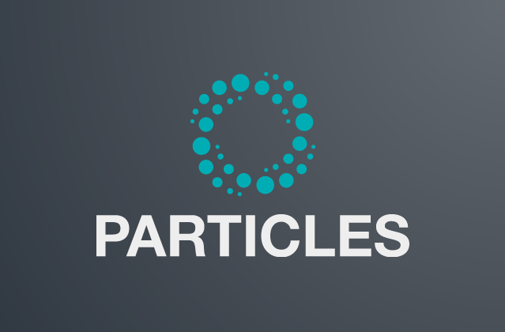

# particles #

Sequential Monte Carlo in python. 

**Modified version — MPI extension for SMC²**  
This repository includes modifications to the original `particles` library to support MPI-based parallel execution of SMC². The original library and its authors are credited below; the MPI extension is described in the next section.

## MPI-based parallelization of SMC² (custom extension)

### Motivation

SMC² performs Bayesian parameter inference for state-space models using a collection of parameter particles. Each parameter particle is associated with a particle filter that estimates the likelihood of the observations. These particle-filter computations can be expensive when many parameter particles are used.

This extension uses the Message Passing Interface (MPI), through `mpi4py`, to distribute particle-filter computations across CPU processes while retaining coordination of the outer SMC² algorithm on rank 0.

### Implementation

The modified implementation is primarily in `particles/smc_samplers.py`, especially the `SMC2` class and its `run_pf_mpi()` method.

- **Rank 0 (master):** Runs the outer SMC² algorithm, including weighting, resampling, and MCMC rejuvenation.
- **MPI processes (including rank 0):** Execute assigned particle filters and compute likelihood estimates.
- **Communication:** MPI collective operations distribute parameter particles, gather likelihood estimates, and exchange particle-filter states as needed during rejuvenation.

The `mpi` option selects the execution path:

- `mpi=0`: Original sequential SMC² execution.
- `mpi=1`: MPI-enabled execution, **provided the calling script implements the corresponding worker loop**.

**Important:** Setting `mpi=1` alone is not sufficient. The calling script must run the outer SMC² algorithm on rank 0 and make the other ranks receive and execute requests using `run_pf_mpi()`. All participating processes must enter MPI collective operations in the same order.

### Additional requirements

The MPI extension requires:

- `mpi4py`
- A compatible MPI runtime, such as Open MPI

The usual dependencies of `particles` are still required. The exact installation and version requirements should be pinned when preparing a reproducible environment.

### Running an MPI example

Once an MPI-aware example script has been added to this repository, it can be launched as follows:

```bash
mpiexec -n 4 python test_smc2_mpi.py
```

This command assumes `test_smc2_mpi.py` exists and contains both the rank-0 SMC² execution path and the worker-side MPI request loop. It is **not** an executable example included by this README alone.

In the current implementation, the number of parameter particles handled by the MPI-enabled SMC² algorithm should be divisible by the number of MPI processes, because equal-size `Scatter` operations are used.

### Scope and attribution

This extension was developed to enable parallel SMC²-based parameter estimation for continuum robot motion-model learning, as part of the research presented in:

**Mahdi Chaari et al.**, *Probabilistic Motion Model Learning for Tendon Actuated Continuum Robots with Backlash*, IEEE/RSJ International Conference on Intelligent Robots and Systems (IROS), 2025.

**DOI:** 10.1109/IROS60139.2025.11246223

**MPI extension:** Mahdi Chaari, ICube Laboratory, University of Strasbourg (2026).

The original `particles` project was developed by Nicolas Chopin and contributors. The following sections describe the original library.

## Motivation ##

This package was developed to complement the following book:

[An introduction to Sequential Monte Carlo](https://www.springer.com/gp/book/9783030478445)

by Nicolas Chopin and Omiros Papaspiliopoulos. 

It now also implements algorithms and methods introduced after the book was
published, see below. 

## Features ##

* **particle filtering**: bootstrap filter, guided filter, APF.

* **resampling**: multinomial, residual, stratified, systematic and SSP. 

* possibility to define **state-space models** using some (basic) form of 
  probabilistic programming; see below for an example. 

* **SQMC** (Sequential quasi Monte Carlo);  routines for computing the Hilbert curve, 
  and generating RQMC sequences. 

* **FFBS (forward filtering backward sampling)**: standard, O(N^2) variant, and
  faster variants based on either MCMC, pure rejection, or the hybrid scheme;
  see Dau & Chopin (2022) for a discussion. The QMC version of Gerber and
  Chopin (2017, Bernoulli) is also implemented.

* **other smoothing algorithms**: fixed-lag smoothing, on-line smoothing,
  two-filter smoothing (O(N) and O(N^2) variants).  

* Exact filtering/smoothing algorithms: **Kalman** (for linear Gaussian models) 
  and **forward-backward recursions** (for finite hidden Markov models).

* **Standard and waste-free SMC samplers**: SMC tempering, IBIS (a.k.a. data
  tempering). SMC samplers for binary words (Schäfer and Chopin, 2014), with
  application to **variable selection**.

* Bayesian parameter inference for state-space models: **PMCMC** (PMMH, Particle Gibbs) 
  and **SMC^2**. 

* Basic support for **parallel computation** (i.e. running multiple SMC algorithms 
  on different CPU cores). 

* **MPI-based parallel SMC² (custom extension)**: distributed particle-filter likelihood evaluation and synchronization during SMC² rejuvenation using `mpi4py`.

* **Variance estimators** (Chan and Lai, 2013 ; Lee and Whiteley, 2018; Olsson
  and Douc, 2019).

* **nested sampling**: both the vanilla version and the SMC sampler of Salomone
  et al (2018).

## Example ##

Here is how you may define a parametric state-space model: 

```python
import particles
import particles.state_space_models as ssm
import particles.distributions as dists

class ToySSM(ssm.StateSpaceModel):
    def PX0(self):  # Distribution of X_0 
        return dists.Normal()  # X_0 ~ N(0, 1)
    def PX(self, t, xp):  # Distribution of X_t given X_{t-1}
        return dists.Normal(loc=xp)  # X_t ~ N( X_{t-1}, 1)
    def PY(self, t, xp, x):  # Distribution of Y_t given X_t (and X_{t-1}) 
        return dists.Normal(loc=x, scale=self.sigma)  # Y_t ~ N(X_t, sigma^2)
```

You may now choose a particular model within this class, and simulate data from it:

```python
my_model = ToySSM(sigma=0.2)
x, y = my_model.simulate(200)  # sample size is 200
```

To run a bootstrap particle filter for this model and data `y`, simply do:

```python
alg = particles.SMC(fk=ssm.Bootstrap(ssm=my_model, data=y), N=200)
alg.run()
```

That's it! Head to the
[documentation](https://particles-sequential-monte-carlo-in-python.readthedocs.io/en/latest/)
for more examples, explanations, and installation instructions. (It is strongly
recommended to start with the
[tutorials](https://particles-sequential-monte-carlo-in-python.readthedocs.io/en/latest/tutorials.html),
to get a general idea on what you can do, and how.)


## Who do I talk to? ##

Nicolas Chopin (nicolas.chopin@ensae.fr) is the main author, contributor, and 
person to blame if things do not work as expected. 

Bug reports, feature requests, questions, rants, etc are welcome, preferably 
on the github page. 

For questions about the MPI-based SMC² extension, contact Mahdi Chaari (chaari.mahdi@outlook.com).
